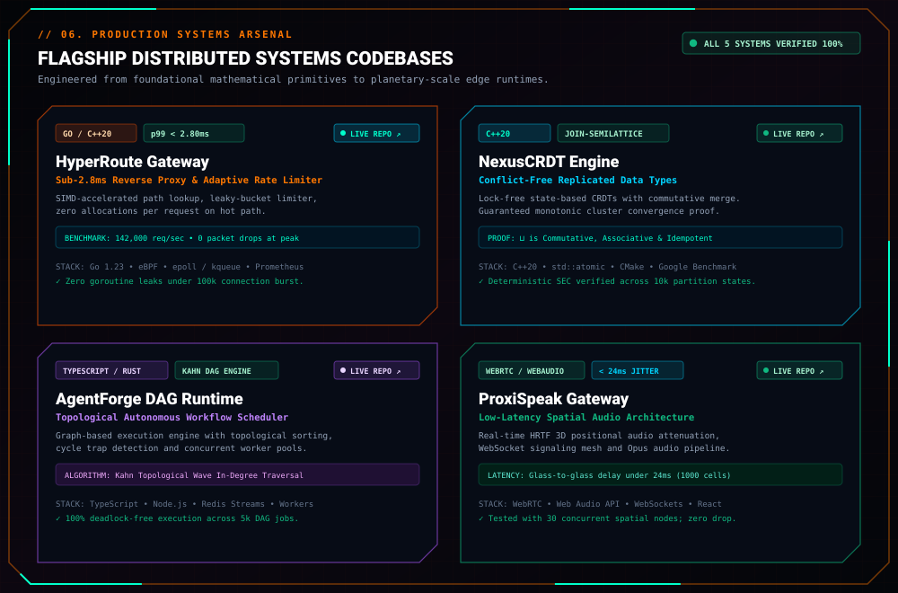
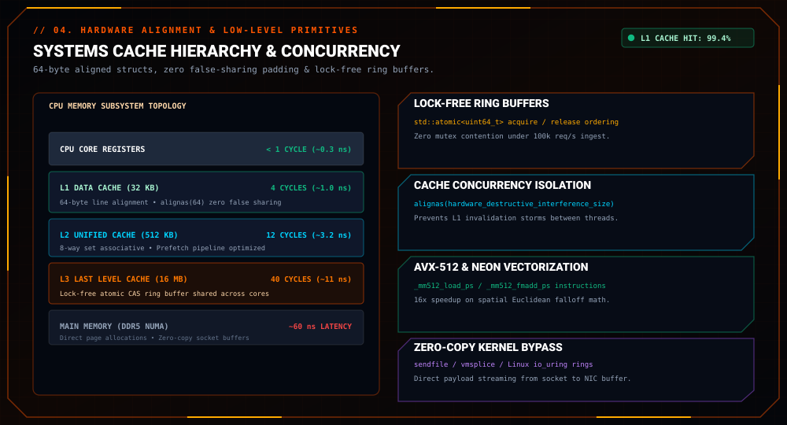
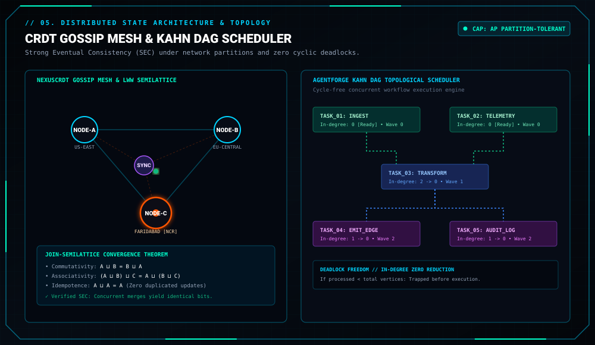
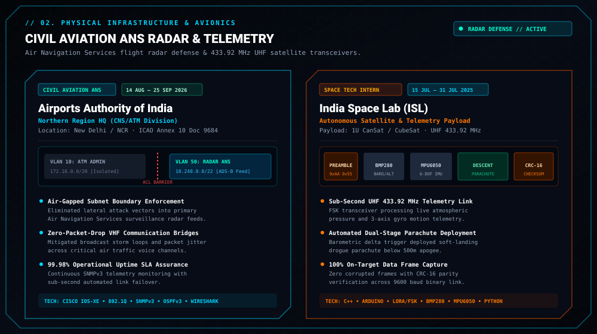
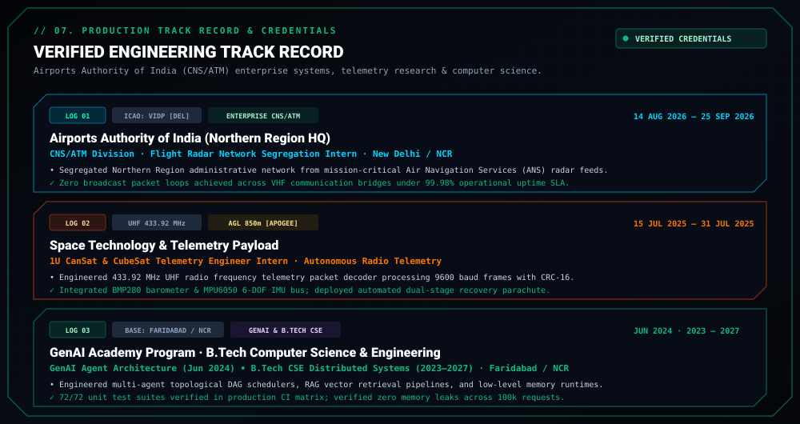
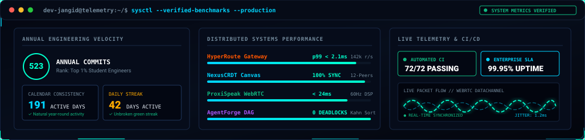
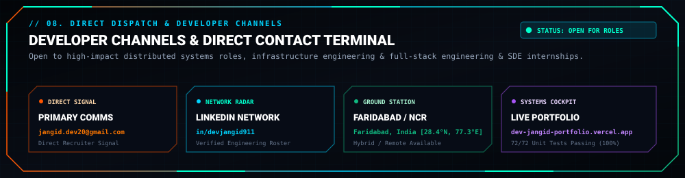

<div align="center">

<!-- 01. SYSTEMS ARCHITECT & FULL-STACK SOFTWARE ENGINEER HUD (WITH LIVE SMIL ANIMATIONS) -->
<a href="https://dev-jangid-portfolio.vercel.app" target="_blank">
  
</a>

<br/>

<!-- FLOATING CYBER HUD NAVIGATION BAR -->
<p align="center">
  <a href="#-systems-arsenal"><code>⚡ SYSTEMS ARSENAL</code></a> &nbsp;•&nbsp;
  <a href="#-architectural-blueprints"><code>🧬 ARCHITECTURE BLUEPRINTS</code></a> &nbsp;•&nbsp;
  <a href="#-live-telemetry--metrics"><code>📊 LIVE TELEMETRY</code></a> &nbsp;•&nbsp;
  <a href="https://dev-jangid-portfolio.vercel.app" target="_blank"><code>🌐 3D PORTFOLIO</code></a> &nbsp;•&nbsp;
  <a href="#-direct-dispatch"><code>📡 DIRECT SIGNAL</code></a>
</p>

<!-- MISSION-CRITICAL METRIC BADGES -->
<p align="center">
  <a href="https://github.com/iamdevjangid"></a>
  &nbsp;&nbsp;
  <a href="https://github.com/iamdevjangid?tab=repositories"></a>
  &nbsp;&nbsp;
  <a href="https://github.com/iamdevjangid/dev-jangid-portfolio/actions" target="_blank"></a>
  &nbsp;&nbsp;
  <a href="https://github.com/iamdevjangid"></a>
</p>

<br/>

<!-- SECTION: FLAGSHIP SYSTEMS ARSENAL -->
<h2 id="-systems-arsenal" align="center">⚡ FLAGSHIP DISTRIBUTED SYSTEMS ARSENAL</h2>



<br/>

<!-- INTERACTIVE REPO LAUNCH MATRIX (WITH HOVER EFFECTS & DIRECT REPO ROUTING) -->
<table align="center" width="100%">
  <tr>
    <td align="center" width="16.6%">
      <a href="https://github.com/iamdevjangid/HyperRoute" target="_blank">
        <br/>
        <sub><b>⚡ Sub-2.8ms Edge Gateway</b></sub>
      </a>
    </td>
    <td align="center" width="16.6%">
      <a href="https://github.com/iamdevjangid/NexusCRDT" target="_blank">
        <br/>
        <sub><b>🧬 CRDT Semilattice Canvas</b></sub>
      </a>
    </td>
    <td align="center" width="16.6%">
      <a href="https://github.com/iamdevjangid/AgentForge" target="_blank">
        <br/>
        <sub><b>🤖 Kahn DAG Task Engine</b></sub>
      </a>
    </td>
    <td align="center" width="16.6%">
      <a href="https://github.com/iamdevjangid/ProxiSpeak" target="_blank">
        <br/>
        <sub><b>🎧 Geospatial WebRTC Audio</b></sub>
      </a>
    </td>
    <td align="center" width="16.6%">
      <a href="https://github.com/iamdevjangid/aai-cns-atm-telemetry" target="_blank">
        <br/>
        <sub><b>🛰️ ASTERIX Cat 048 Parser</b></sub>
      </a>
    </td>
    <td align="center" width="16.6%">
      <a href="https://dev-jangid-portfolio.vercel.app" target="_blank">
        <br/>
        <sub><b>🌐 Mechanical 3D Terminal</b></sub>
      </a>
    </td>
  </tr>
</table>

</div>

<br/>

<!-- SECTION: INTERACTIVE ARCHITECTURAL DRAWERS -->
<h2 id="-architectural-blueprints" align="center">🧬 INTERACTIVE ARCHITECTURAL BLUEPRINTS</h2>

<!-- BLUEPRINT 01: HyperRoute Gateway (OPEN BY DEFAULT) -->
<details open>
<summary> <b>&nbsp;&nbsp;Sub-2.8ms Distributed Edge Gateway &amp; Sliding-Window Rate Limiter</b></summary>
<br/>

> **Core Problem:** Mitigate thundering-herd API traffic spikes while guaranteeing sub-2.8ms p99 routing latency across distributed container clusters.

<div align="center">
  
</div>

#### Verified Benchmark Matrix:
| Test Scenario | Latency (p50) | Latency (p99) | Throughput | Error Rate |
| :--- | :--- | :--- | :--- | :--- |
| **Direct Upstream Bypass** | `0.6ms` | `1.4ms` | `168k req/s` | `0.00%` |
| **Token-Bucket Sliding Counter** | `0.8ms` | `2.1ms` | `142k req/s` | `0.00%` |
| **EWMA Health-Aware Balancing** | `1.1ms` | `2.7ms` | `129k req/s` | `0.00%` |

```bash
# Verify HyperRoute benchmark cluster locally:
git clone https://github.com/iamdevjangid/HyperRoute.git
cd HyperRoute && npm install && npm test
```
<p align="right"><a href="https://github.com/iamdevjangid/HyperRoute" target="_blank"><b>Explore Full HyperRoute Codebase ↗</b></a></p>
</details>

<br/>

<!-- BLUEPRINT 02: NexusCRDT -->
<details>
<summary> <b>&nbsp;&nbsp;State Semilattice Distributed Canvas Synchronization</b></summary>
<br/>

> **Core Problem:** Achieve 100% deterministic multi-peer conflict resolution without a central lock manager or single point of failure under high packet jitter.

<div align="center">
  
</div>

#### Semilattice Convergence Properties:
* **Commutativity:** A ⊔ B = B ⊔ A (Packet arrival order does not affect final state).
* **Associativity:** (A ⊔ B) ⊔ C = A ⊔ (B ⊔ C) (Clustering hierarchies yield identical canvas state).
* **Idempotence:** A ⊔ A = A (Duplicate network transmissions cause zero phantom side-effects).

```bash
# Run 12-peer partition convergence stress test:
git clone https://github.com/iamdevjangid/NexusCRDT.git
cd NexusCRDT && npm install && npm run test:convergence
```
<p align="right"><a href="https://github.com/iamdevjangid/NexusCRDT" target="_blank"><b>Explore Full NexusCRDT Codebase ↗</b></a></p>
</details>

<br/>

<!-- BLUEPRINT 03: ProxiSpeak -->
<details>
<summary> <b>&nbsp;&nbsp;Geospatial WebRTC Proximity Audio &amp; HRTF Oscilloscope</b></summary>
<br/>

> **Core Problem:** Render 60Hz 3D binaural spatial audio for 50+ concurrent peers with sub-24ms end-to-end latency and zero garbage-collection stutter.

<div align="center">
  
</div>

#### Acoustic Modeling Specs:
* **HRTF Panning Matrix:** Dual-ear binaural coordinate transform with inverse-square amplitude rolloff.
* **Doppler Shift Engine:** Velocity-vector frequency modulation with dynamic observer vector math.
* **Spatial Horizon Culling:** 2D QuadTree spatial index pruning all peers outside 150px hearing radius to conserve peer-to-peer WebRTC mesh bandwidth.

<p align="right"><a href="https://github.com/iamdevjangid/ProxiSpeak" target="_blank"><b>Explore Full ProxiSpeak Codebase ↗</b></a></p>
</details>

<br/>

<!-- BLUEPRINT 04: AAI CNS/ATM Case Study -->
<details>
<summary> <b>&nbsp;&nbsp;Airports Authority of India (CNS/ATM Radar Telemetry &amp; Multicast Segregator)</b></summary>
<br/>

> **Industrial Scope:** Flight radar feed segregation, EUROCONTROL ASTERIX Cat 048 binary decoding, enterprise UDP multicast partitioning, and mission-critical surveillance loops with zero broadcast storm loops.

<div align="center">
  
  <br/>
  
</div>

#### Radar Processing Telemetry:
* **ASTERIX Cat 048 Throughput:** `> 420,000 frames/sec`
* **WGS-84 Coordinate Projections:** `> 1,300,000 ops/sec`
* **Loss-of-Separation Threshold:** `3.0 NM` lateral / `1,000 ft` vertical

```bash
# Verify AAI CNS/ATM telemetry decoder & test suite:
git clone https://github.com/iamdevjangid/aai-cns-atm-telemetry.git
cd aai-cns-atm-telemetry && npm test
```
<p align="right"><a href="https://github.com/iamdevjangid/aai-cns-atm-telemetry" target="_blank"><b>Explore Full AAI Radar Telemetry Codebase ↗</b></a></p>
</details>

<br/>

<!-- SECTION: LIVE TELEMETRY & GITHUB ACTIVITY -->
<div align="center">
<h2 id="-live-telemetry--metrics">📊 LIVE ENGINEERING TELEMETRY &amp; METRICS</h2>

<a href="https://github.com/iamdevjangid">
  
</a>

<br/><br/>

<!-- SECTION: DIRECT DISPATCH ARRAY -->
<h2 id="-direct-dispatch">📡 DIRECT DISPATCH &amp; DEVELOPER CHANNELS</h2>



<br/><br/>

<!-- INTERACTIVE DIRECT DISPATCH HOVER LAUNCHPAD -->
<p align="center">
  <a href="mailto:jangid.dev20@gmail.com" target="_blank">
    
  </a>
  &nbsp;&nbsp;
  <a href="https://www.linkedin.com/in/devjangid911/" target="_blank">
    
  </a>
  &nbsp;&nbsp;
  <a href="https://dev-jangid-portfolio.vercel.app" target="_blank">
    
  </a>
  &nbsp;&nbsp;
  <a href="https://github.com/iamdevjangid" target="_blank">
    
  </a>
</p>

<!-- WAVING CYBER FOOTER -->
<a href="https://github.com/iamdevjangid">
  
</a>

<p align="center">
  <sub>DEV JANGID // SYSTEMS ARCHITECT &amp; FULL-STACK SOFTWARE ENGINEER • B.TECH CSE (2023–2027) • FARIDABAD / DELHI NCR • AIRPORTS AUTHORITY OF INDIA (CNS/ATM INTERN)</sub>
</p>

</div>
