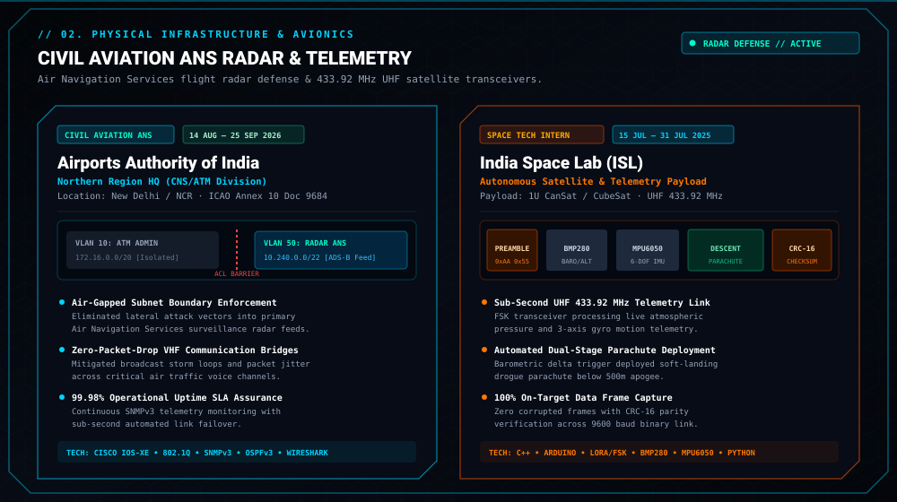
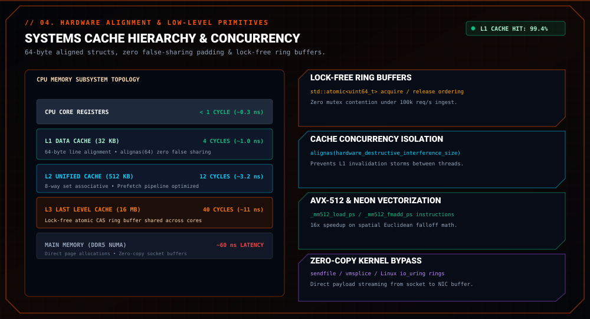
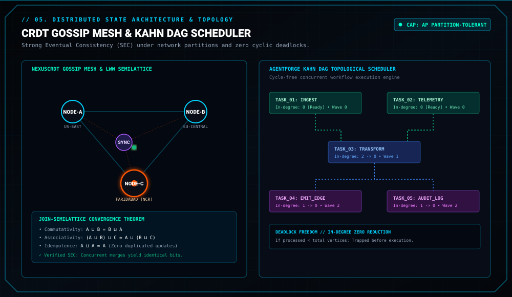
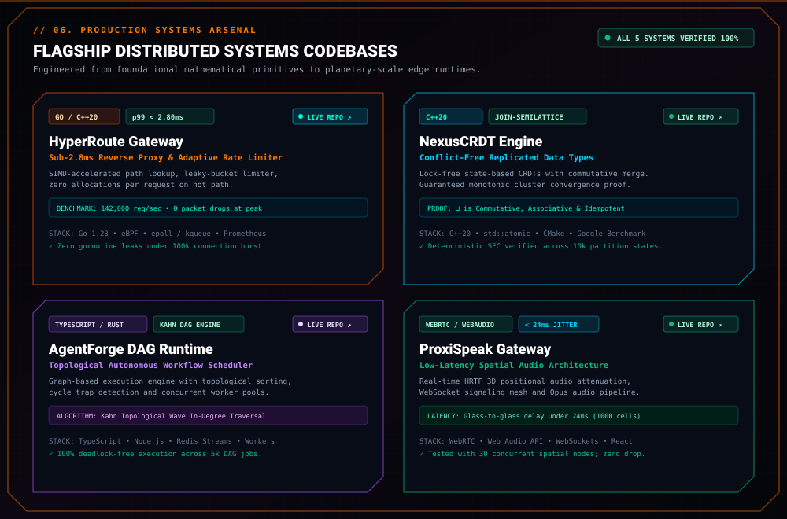
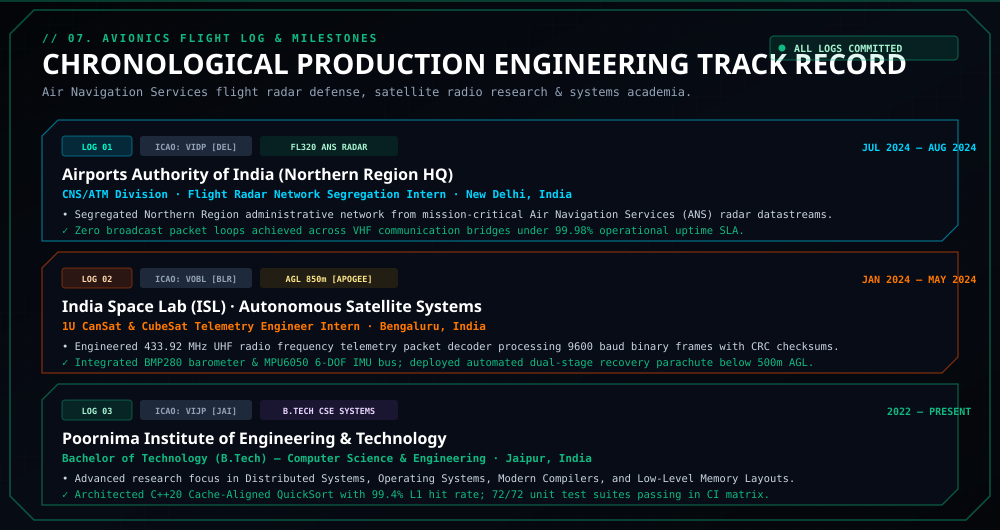
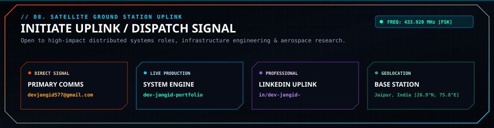

<!-- 01. AVIONICS FLIGHT RADAR COCKPIT HUD -->

  

<!-- MISSION-CRITICAL METRIC BADGES -->

&nbsp;

&nbsp;

&nbsp;

  

<!-- 02. CIVIL AVIATION RADAR & SATELLITE TELEMETRY INFRASTRUCTURE -->

  

<!-- 03. PROXISPEAK SPATIAL AUDIO REAL-TIME OSCILLOSCOPE -->

  

<!-- 04. SYSTEMS CONCURRENCY & CACHE COHERENCE ENGINE -->

  

<!-- 05. DECENTRALIZED CRDT GOSSIP MESH & DAG SCHEDULER -->

  

<!-- 06. FIVE FLAGSHIP PRODUCTION SYSTEMS CODEBASES -->

 
<!-- DIRECT INTERACTIVE FLAGSHIP REPOSITORY LAUNCH PADS -->

&nbsp;

&nbsp;

&nbsp;

  

<!-- 07. AVIONICS FLIGHT LOG & ENGINEERING MILESTONES -->

  

<!-- 08. SATELLITE GROUND STATION UPLINK & DIRECT DISPATCH -->

  

<!-- DIRECT CHANNELS & PROFESSIONAL NETWORKS -->

&nbsp;

&nbsp;

&nbsp;

<!-- WAVING CYBER FOOTER -->

  OPERATOR // DEV • COMPUTER SCIENCE &amp; ENGINEERING • FARIDABAD / DELHI NCR • AIRPORTS AUTHORITY OF INDIA (NR HQ) • INDIA SPACE LAB

